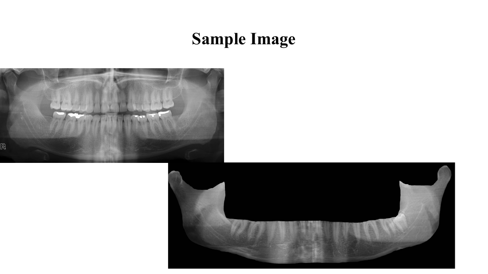
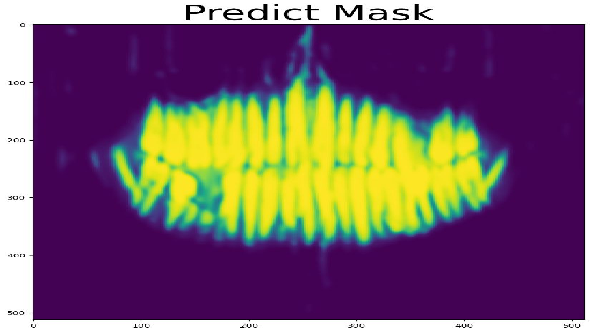
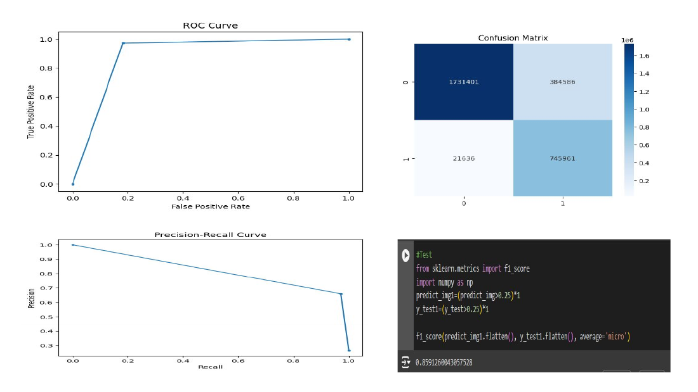

# Teeth structure segmentation in panoramic dental X-rays

Final-year BTech project, Computer Science and Medical Engineering, Sri Ramachandra Institute of Higher Education and Research, Chennai (2024).
Devaharish Srikannan supervised by Mrs Rhevathi M.

We trained a U-Net in PyTorch to segment teeth in panoramic dental X-rays, with simple image pre-processing before training.

## Data

Panoramic dental X-rays of 116 anonymised patients from the Noor Medical Imaging Center, Qom, Iran, covering healthy, partially edentulous and fully edentulous cases. The dataset was published by Abdi et al.: https://data.mendeley.com/datasets/hxt48yk462/1

The X-rays are not included in this repository. Please download them from the source above.

## Method

1. Pre-processing: Gaussian blur and median filtering to reduce noise, then normalisation.
2. Model: a standard U-Net (four down-sampling and four up-sampling blocks, 64 to 1024 channels, double 3x3 convolutions with ReLU).
3. Training: cross-entropy loss, Adam optimiser (learning rate 0.001), batch size 8, 25 epochs.
4. Evaluation: pixel-level comparison of predicted and reference masks after thresholding at 0.25.

## Results

Pixel counts on the test images:

| | Predicted background | Predicted teeth |
|---|---:|---:|
| **Background** | 1,731,401 | 384,586 |
| **Teeth** | 21,636 | 745,961 |

| Metric | Value |
|---|---:|
| Pixel accuracy | 0.859 |
| Teeth Dice (F1) | 0.786 |
| Teeth IoU | 0.647 |
| Precision (teeth) | 0.66 |
| Recall (teeth) | 0.97 |

In the original project report we quoted "F1 0.859". That number came from a micro-averaged F1 over every pixel, which for a two-class mask is the same as pixel accuracy. The Dice score for the teeth class alone is 0.786. The model finds almost all tooth pixels (recall 0.97) but also marks a lot of surrounding bone as tooth (precision 0.66), which you can see in the predicted mask above.

## What I would do differently now

- Split the data by patient and keep a held-out test set that is never used for tuning.
- Report Dice and IoU per class, and per image, rather than one number over all pixels.
- Look at the false positives around the roots and the jaw bone, which make up most of the error.

## Files

- `docs/project_slides.pdf`: slides from the final project review (dataset, workflow, code and results).
- `figures/`: images taken from those slides.
